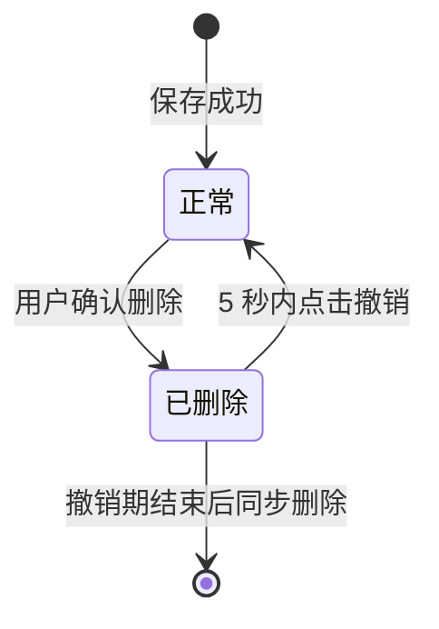
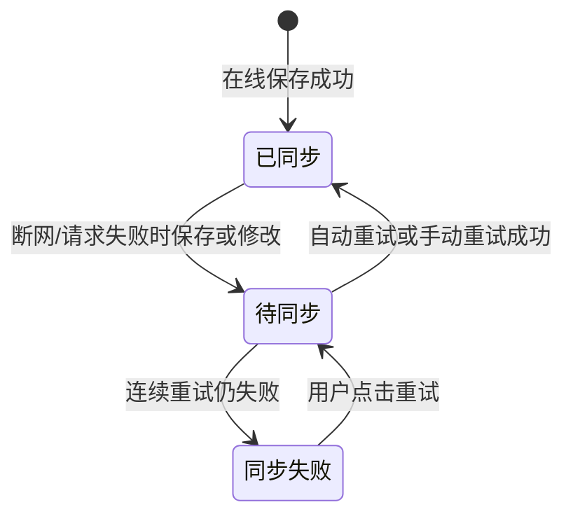
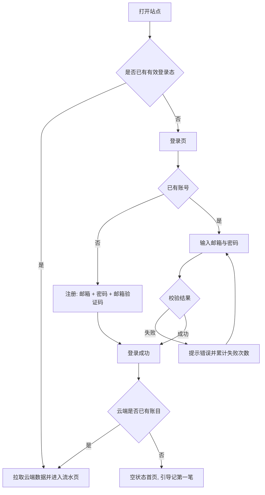
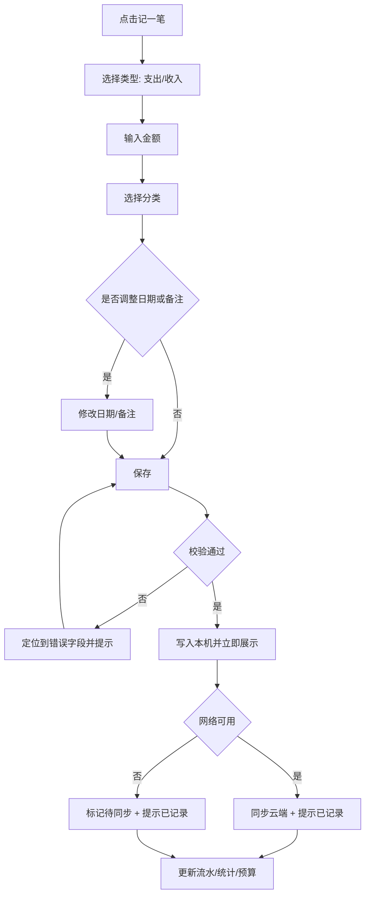
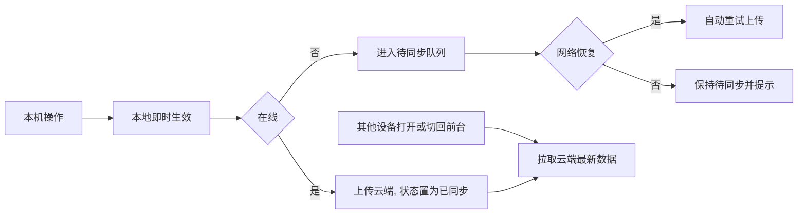
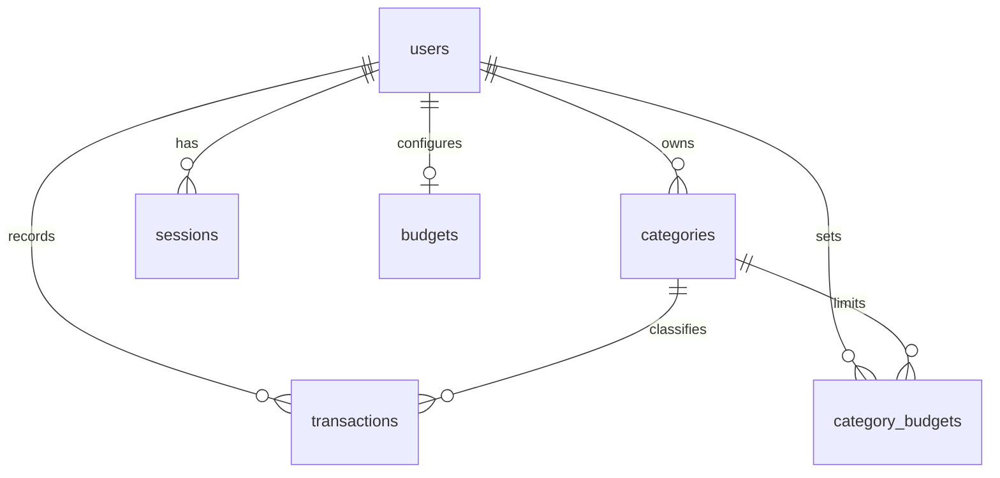

# 个人记账 Web 应用 PRD

| 项目 | 内容 |
| --- | --- |
| 产品名称 | 个人记账（暂定名） |
| 版本 | v1.3（第一版 / MVP，含后端数据模型与主题规范） |
| 终端 | Web 网页端，手机浏览器与桌面浏览器均可使用（移动优先） |
| 数据形态 | 账号体系 + 云端同步，本地缓存支持离线记账 |
| 文档状态 | 待评审 |
| 更新日期 | 2026-11-11 |

---

## 1. 背景与目标

### 1.1 背景

用户每天都会产生消费，需要逐笔记录下来，才能知道钱花在了哪里、这个月还能不能继续花。当前的手动记账方式（备忘录、聊天记录、Excel）存在四个稳定问题：

- **记录成本高**：每笔都要重新选择格式、手动算合计，记几天就会放弃。
- **账目分散**：记录位置不固定，月底无法一次汇总，容易漏记、重复记。
- **只有明细没有结论**：即使记全了，也看不出本月总额、哪类花得多、是否超过自己的承受范围。
- **只有一个数字**：只记支出时，用户不知道自己这个月到底"剩下了多少"，无法判断收支是否健康。

### 1.2 产品决策

做一个解决"随手记 + 看得懂 + 换设备不丢"的轻量记账工具：

1. 用**最少字段 + 自定义数字键盘**把单笔记账压缩到 30 秒内完成；
2. 同时记录**支出与收入**，按月给出支出、收入与**结余**，让"这个月还剩多少"成为可见结论；
3. 引入**可配置周期的预算**，把"还能不能继续花"变成可判断的数字，并在接近/超出预算时提示；
4. 以**账号 + 云端同步**为数据底座，手机与电脑看到的是同一份账，换设备登录即恢复。

### 1.3 目标（以可观察的结果描述）

- 用户能在打开页面的 30 秒内完成一笔记录，并看到金额已计入当日流水与当月统计。
- 用户能在统计页直接回答四个问题：本月收入多少、支出多少、结余多少、钱主要花在哪。
- 设置预算后，用户在接近预算、超出预算时都能收到明确提示，且该提示不阻断继续记录。
- 用户在同一账号下更换设备登录，能看到与上一台设备一致的账目、分类与预算。
- 用户在断网状态下仍能记录，网络恢复后无需手动操作即可完成同步。

---

## 2. 用户与使用场景

### 2.1 用户

- **主用户**：个人用户，用账号为自己记账，单人使用，不涉及家庭共享、企业报销、多角色协作。
- **使用设备**：以手机浏览器为主（消费发生当场记录），桌面浏览器为辅（月底回看、整理）；同一账号允许同时在多台设备登录。
- **使用习惯**：每天 1–5 笔，随手记；收入每月 1–5 次；多数不会当天补充备注，月底集中回看。

### 2.2 产品契约

| 项目 | 定义 |
| --- | --- |
| 用户 | 持有账号的个人用户，账号之间数据完全隔离 |
| 触发 | 发生一笔支出或收入后立即记录；或每日/月底集中补记 |
| 核心任务 | 快速记录一笔收支，并随时掌握本月收入、支出、结余与预算余量 |
| 完成条件 | 保存后该笔金额出现在流水列表，并计入当月收入或支出、结余与预算已用；用户能看到保存成功反馈 |
| 信任基础 | 金额计算准确；数据保存在云端，换设备登录后账目一致；离线记录不丢失；数据可导出 |

### 2.3 核心场景

| 场景 | 用户动作 | 产品响应 |
| --- | --- | --- |
| 首次使用 | 注册并登录 | 进入空状态首页，引导记录第一笔 |
| 随手记一笔支出 | 打开页面 → 输入金额 → 选分类 → 保存 | 反馈"已记录 ¥25.00 · 餐饮"，列表、当月统计与预算即时更新 |
| 记一笔工资 | 记一笔中切换到"收入" → 输入金额 → 选"工资" → 保存 | 当月收入与结余同步更新 |
| 补记昨天的账 | 记账时把日期改为昨天 | 记录归入昨天所在月份，统计按发生日期重算 |
| 月底回看 | 打开统计页 | 看到本月收入、支出、结余、分类构成、环比与 6 个月趋势 |
| 预算控制 | 设置预算与周期起始日 → 继续记账 | 预算进度随周期内支出变化，跨过 80%/100% 时提示 |
| 记错了 | 在流水中点击该笔 → 修改或删除 | 修改后统计即时重算；删除有二次确认与 5 秒撤销 |
| 换手机 | 新设备登录同一账号 | 自动拉取云端账目、分类与预算，无需导入文件 |
| 断网记账 | 地铁里记录一笔 | 记录立即保存到本机并标记待同步，联网后自动同步 |
| 数据留档 | 设置页导出备份 | 下载 JSON 备份与 CSV 账单 |

---

## 3. 范围

### 3.1 P0（本版必须完成）

| 编号 | 能力 | 说明 |
| --- | --- | --- |
| FR-01 | 记一笔 | 支出/收入切换，金额、分类、日期、备注的录入与保存 |
| FR-02 | 流水列表 | 按月查看、按日分组、按类型筛选、搜索 |
| FR-03 | 流水编辑与删除 | 修改（含改类型）、删除、撤销删除 |
| FR-04 | 分类管理 | 支出与收入两套分类，内置 + 自定义的增删改停用 |
| FR-05 | 月度统计 | 收入、支出、结余、日均、分类构成、环比、6 个月趋势 |
| FR-06 | 预算 | 可配置周期起始日的总预算与分类预算、进度与阈值提示 |
| FR-07 | 数据备份与恢复 | JSON 全量备份/恢复、CSV 账单导出 |
| FR-08 | 账号与登录 | 注册、登录、找回密码、退出、注销 |
| FR-09 | 云同步与离线 | 多设备一致、待同步队列、冲突处理、同步状态展示 |
| FR-10 | 基础设置 | 账号管理、数据管理、外观、分类与预算入口、关于信息 |
| FR-11 | 外观与主题 | 默认马卡龙紫，支持 4 套预设主题切换并随账号同步 |

以上构成"登录 → 记录 → 查看 → 复盘 → 控制 → 多设备一致"的完整闭环。

### 3.2 P1（下一版）

- 手机号登录、微信等第三方登录；
- 账户/支付方式维度（微信、支付宝、银行卡、现金）及按账户统计；
- 更多统计维度：按星期、按备注关键词、年度报告；
- 记账提醒（定时提醒、浏览器通知）；
- 图片票据附件、账单批量导入（支付宝/微信账单）；
- 深色模式、自由取色与自定义主题；
- 预算历史快照与逐月差异化预算。

### 3.3 本版不做

- 多账本（生活账、旅行账、家庭账）与多人共享账本；
- 多币种与汇率换算；
- 二级分类、标签体系；
- 自动识别短信/推送生成账单；
- 投资、资产负债、信用卡还款等资产负债权管理。

> 上述内容若不做明确排除，容易在评审时被理解为"顺手就能加"，故在此显式声明为 P1 或不做。

---

## 4. 产品模型

### 4.1 对象

**账号（Account）**：数据归属主体，也是多设备一致的基础。

| 字段 | 说明 |
| --- | --- |
| 邮箱 | 登录标识，全局唯一，注册后不可修改 |
| 密码 | 8–32 位，至少包含字母与数字，不以明文形式保存 |
| 注册时间 | 系统生成 |
| 上次登录时间 | 系统生成，用于账号安全展示 |
| 状态 | 正常 / 已注销（注销后不可恢复，数据立即删除） |

**流水（Transaction）**：一笔支出或收入，是产品的核心对象。

| 字段 | 必填 | 类型 / 范围 | 默认值 | 说明 |
| --- | --- | --- | --- | --- |
| 类型 | 是 | 支出 / 收入 | 支出 | 决定分类范围与统计归属 |
| 金额 | 是 | 0.01–9,999,999.99，最多两位小数 | 空 | 正数，不支持负数与 0；类型决定其在统计中的方向 |
| 分类 | 是 | 与类型一致的启用分类 | 空 | 不预选，避免误记 |
| 发生日期 | 是 | 今天及以前的任意日期 | 今天 | 不允许未来日期 |
| 备注 | 否 | 文本，≤50 字 | 空 | 不参与计算，仅用于搜索与识别 |
| 创建时间 | 系统生成 | 时间戳 | — | 同日内排序与审计 |
| 更新时间 | 系统生成 | 时间戳 | — | 多端同步与冲突判定依据 |
| 业务状态 | 系统生成 | 正常 / 已删除 | 正常 | 已删除不参与列表、统计与预算 |
| 同步状态 | 系统生成 | 已同步 / 待同步 / 同步失败 | 已同步 | 仅在离线或异常时对用户可见 |

**分类（Category）**：收支的分类维度，支出与收入各自独立。

| 字段 | 说明 |
| --- | --- |
| 名称 | ≤8 个字符，同一类型下不可重名（支出与收入可同名） |
| 类型 | 支出 / 收入 |
| 颜色 | 从 8 色预设色板中选择，用于列表图标与统计图 |
| 来源 | 内置 / 自定义 |
| 状态 | 启用 / 停用（停用后不可用于新记录，历史记录保留） |
| 排序 | 影响记账选择器与分类管理页的展示顺序 |

内置支出分类 12 个：餐饮、买菜、交通、购物、居住、水电、通讯、娱乐、医疗、学习、人情、其他。
内置收入分类 7 个：工资、奖金、兼职、理财收益、红包、报销、其他。

**预算（Budget）**：按用户自定义周期循环生效的支出上限。

| 字段 | 说明 |
| --- | --- |
| 总预算 | 每个周期的支出上限，>0 时生效；未设置时不展示进度与提示 |
| 分类预算 | 可选，针对单个支出分类设置的上限；与总预算不强制相等 |
| 周期起始日 | 1–28，默认 1；周期为"每月 X 日至次月 X−1 日" |
| 生效方式 | 设置后每个周期自动沿用，无需逐周期重设 |

**设置（Settings）**：包含账号操作、数据管理入口与主题偏好。默认主题为马卡龙紫，可在 4 套预设主题间切换，偏好随账号同步；不提供货币切换、字号调整等个性化项。

### 4.2 状态

流水有两个业务状态和一个同步状态，删除采用"软删除 + 限时撤销"：





- 已删除记录在撤销期内不出现在列表、统计与预算计算中，也不会同步到其他设备。
- 撤销期结束、页面关闭或重新进入应用后，删除生效并同步到云端，不可再恢复。
- 分类状态为"启用 / 停用"，停用只是从记账选择器中隐藏，历史流水与统计口径不变。

### 4.3 计算口径

以下口径为全产品唯一标准，各功能章节不再重复定义。

| 指标 | 计算规则 |
| --- | --- |
| 金额精度 | 以"分"为最小单位存储与计算；展示保留两位小数，千分位分隔 |
| 归属月份 | 以发生日期所在自然月为准，与创建时间无关 |
| 月度支出总额 | 当月全部"正常"状态支出流水金额之和 |
| 月度收入总额 | 当月全部"正常"状态收入流水金额之和 |
| 月度结余 | 月度收入总额 − 月度支出总额；可为负数 |
| 结余率 | 月度结余 ÷ 月度收入总额 × 100%，保留一位小数；收入为 0 时显示"—" |
| 日均支出 | 月度支出总额 ÷ 当月已过天数；查看当前月时含今天，查看历史月时取该月总天数 |
| 分类构成占比 | 该分类合计 ÷ 同类型月度总额，保留一位小数；四舍五入后合计可能不等于 100%，不强制补齐 |
| 环比 | （本月某类型总额 − 上月同类型总额）÷ 上月同类型总额 × 100%，保留一位小数；上月为 0 时显示"—"；结余只展示绝对变化额，不展示百分比 |
| 预算周期 | 起始日 X 对应区间"本月 X 日 00:00 至次月 (X−1) 日 24:00"；X=1 时等同自然月 |
| 预算已用 | 当前预算周期内支出流水金额之和（与自然月支出无关） |
| 预算剩余 | 预算金额 − 预算已用，允许为负数 |
| 预算消耗率 | 预算已用 ÷ 预算金额 × 100%，展示为整数百分比 |
| 分类预算已用 | 当前预算周期内该分类支出合计 |

---

## 5. 核心流程

### 5.1 首次使用与登录



### 5.2 记录一笔的闭环



### 5.3 多设备与离线



---

## 6. 功能需求

### FR-01 记一笔

**目的**：以最少的操作完成一笔支出或收入记录，这是产品的核心入口。

**入口**

- 移动端：底部导航中间的悬浮"+"按钮；
- 桌面端：左侧导航"记一笔"按钮，同时在流水页顶部提供入口；
- 记账页以全屏页面（移动端底部抽屉式）呈现，不跳转新标签页。

**布局**

1. 顶部：关闭按钮 + 标题"记一笔"；
2. 类型切换：支出 / 收入分段控件，默认"支出"；
3. 金额区：大号金额显示，居中，未输入时显示"0.00"占位；
4. 分类区：当前类型下的分类横向可滚动图标列表，每行 4–5 个；
5. 附注区：日期选择（默认今天）、备注输入；
6. 底部：保存按钮，固定可见。

**交互规则**

| 项目 | 规则 |
| --- | --- |
| 类型切换 | 切换类型时，已选分类被清空并要求重新选择；金额、日期、备注保留；当前类型下无可用分类时提示"该类型还没有分类"并给出去分类管理的入口 |
| 金额输入 | 使用应用内自定义数字键盘（0–9、小数点、退格），一次性输入；最多两位小数；最多 9 位整数；不允许以小数点开头；整数部分不允许前导 0（如 05） |
| 分类选择 | 单选，切换分类时高亮当前项；最近一次使用的同类型分类排在最前并带"最近"标识，但默认不选中 |
| 日期 | 默认今天；日期选择器不可选择未来日期；选择后字段显示"今天 / 昨天 / 10月12日" |
| 备注 | 选填，最多 50 字，超出不可继续输入并显示字数计数 |
| 保存 | 金额与分类都有效时才可点击；点击后 500ms 内在界面呈现结果 |
| 保存反馈 | Toast 显示"已记录 支出 ¥25.00 · 餐饮"或"已记录 收入 ¥8,000.00 · 工资"，同时关闭记账页；页面底部同时保留"再记一笔"按钮（2 秒内可见），点击后回到记账页且金额、备注清空，类型、日期与分类保持上一次的选择 |
| 键盘快捷键（桌面） | Enter 保存，Esc 关闭；存在未保存内容时关闭需确认 |

**校验与异常**

| 情况 | 处理 |
| --- | --- |
| 金额为空、为 0 或未选分类 | 保存按钮置灰不可点；若用户点击，滚动定位到问题字段并提示"请输入金额""请选择分类" |
| 金额超过上限 | 键入第 10 位整数时不再接受输入，并提示"单笔金额不能超过 9,999,999.99" |
| 日期选为未来 | 日期选择器中不可选 |
| 未登录/登录态失效 | 不进入记账页，跳转登录页；登录成功后回到流水页，不自动打开记账页 |
| 离线保存 | 照常保存并提示"已保存到本机，联网后自动同步"，记录标识为待同步 |
| 云端写入失败 | 记录保留在本机并标记待同步，不丢失用户输入；提示条提供"重试" |

### FR-02 流水列表

**目的**：按时间回看每一笔收支，并能快速找到某一类或某一笔记录。

**布局**

1. 月份切换条：上一月 / 当前月份文字 / 下一月，当前月不可再往后切换；
2. 月份摘要条：本月支出合计、收入合计、结余，三者并列展示；
3. 筛选栏：类型、分类、日期范围、金额区间、关键词搜索，收起状态只显示"筛选"入口，已应用条件以标签形式展示，可单独移除；
4. 流水列表：按发生日期倒序分组，日期头显示该日小计（如"10月12日 周六 · 支出 ¥86.00 · 收入 ¥0.00"），组内按创建时间倒序；
5. 列表项：分类色块 + 分类名 + 备注（无备注时只显示分类名）+ 右侧金额；支出显示为"−¥25.00"，收入显示为"+¥8,000.00"，收入使用不同的文字色并附带类型文字，不单靠颜色区分。

**规则**

| 项目 | 规则 |
| --- | --- |
| 默认月份 | 打开应用时为当前自然月 |
| 分组小计 | 按发生日期分组，仅统计正常状态记录，支出与收入分别汇总 |
| 加载 | 每次加载 20 条，滚动到底部自动加载更多；筛选后按同样规则加载 |
| 点击 | 点击列表项进入该笔记录的详情/编辑页 |
| 空状态 | 当月无记录时展示"本月还没有记录"+ 直接记一笔按钮；筛选无结果时展示"没有符合条件的记录"+ 清除筛选按钮 |
| 筛选条件 | 切换月份时保留筛选条件并重新查询；应用内本次会话保持，刷新页面后重置 |
| 搜索 | 匹配备注文本，不区分大小写；搜索与筛选可叠加 |
| 数据准确性 | 编辑、删除或同步完成后，列表、月份摘要、统计页与预算进度同时刷新，不允许出现旧数据 |

**筛选字段**

| 筛选项 | 类型 | 说明 |
| --- | --- | --- |
| 类型 | 单选 | 全部 / 支出 / 收入 |
| 分类 | 多选 | 随类型联动：类型为"全部"时分支出与收入两组展示；选中支出分类时不会命中收入记录 |
| 日期范围 | 日期区间 | 限定在当前所选月份内，跨月需切换月份 |
| 金额区间 | 最小值 / 最大值 | 支持只填一端；最小值 > 最大值时提示并阻止应用 |
| 关键词 | 文本 | 匹配备注 |

### FR-03 流水编辑与删除

**目的**：记错时能低成本修正，且修正后所有统计结果同步准确。

**详情/编辑**

- 从流水列表点击进入，复用记一笔页面的结构与规则，标题改为"编辑"。
- 修改任意字段后保存，提示"已更新"，返回列表并即时刷新本月收支、结余、分类构成与预算进度。
- 允许修改类型（支出 ↔ 收入）。切换类型后分类必须重新选择，保存后该笔从原类型的统计中移除并计入新类型。
- 日期可改到过去任意日期；改到其他月份时，该笔从原月份列表移除、出现在新月份，两个月份统计同步重算。
- 未做任何修改时，关闭页面不提示；有未保存修改时关闭需二次确认。

**删除**

- 入口：详情页右上角"删除"，或列表项左滑（移动端）/悬浮菜单（桌面端）。
- 删除前弹窗确认，弹窗内显示"删除这笔 支出 ¥25.00 · 餐饮？"，按钮为"取消 / 删除"。
- 确认后立即从列表、统计与预算中移除，并提示"已删除 · 撤销"，撤销按钮有效期 5 秒。
- 点击撤销后记录恢复原状，列表与统计重算，且不再向云端提交删除。
- 撤销期结束后删除同步到云端，其他设备在下次同步时不再显示该记录；本版不提供独立的"回收站"，也不支持跨设备撤销。

### FR-04 分类管理

**目的**：让分类贴合个人收支结构，同时避免分类变动破坏历史账目。

**列表**

- 入口：设置页 → 分类管理。
- 顶部以"支出 / 收入"切换两套分类，各自分为"内置分类"与"自定义分类"两组，每项显示颜色、名称、当月该类型合计金额。
- 支持拖动排序（移动端长按拖动，桌面端拖拽），排序仅影响记账选择器与分类管理页的展示顺序。

**内置分类**

- 支出内置 12 个、收入内置 7 个，均不可删除、不可改名、不可改颜色；
- 不可停用；
- 允许排序。

**自定义分类**

| 操作 | 规则 |
| --- | --- |
| 新建 | 需选择类型（支出/收入），名称 ≤8 字，同一类型下不可重名；颜色从 8 色预设中选择；创建后立即出现在对应类型的记账选择器 |
| 改名 | 校验同上；历史流水随分类一起展示新名称 |
| 改颜色 | 列表图标与统计图同步更新 |
| 停用 | 停用后不再出现在记账选择器，历史流水仍保留并参与统计；可重新启用 |
| 删除 | 无关联流水时二次确认后直接删除；有关联流水时，必须先选择"迁移到其他"（将该分类下全部流水移到同类型的"其他"分类）或取消删除，不可直接删除 |

**空状态与异常**

- 某类型下自定义分类为空时，展示"还没有自定义分类"及新建入口；
- 名称重复时提示"已存在同名分类"并阻止提交；
- 名称为空或全为空格时阻止提交。

**边界**

- 每种类型的自定义分类上限为 50 个，达到上限后隐藏新建入口并提示。

### FR-05 月度统计

**目的**：把明细自动变成结论，让用户能判断本月收支是否健康、钱花在哪里。

**布局（自上而下）**

1. 月份切换条，与流水列表一致；
2. 收支卡：本月收入、本月支出、本月结余（三列），并附结余率、日均支出、笔数；
3. 预算卡：仅当查看当前自然月且已设置预算时展示，展示当前预算周期的起止日、预算、已用、剩余与消耗率进度条；
4. 分类构成：支出构成 / 收入来源 两个切换标签；每个标签下展示环形图 + 分类排行（分类名、金额、占比），按金额降序，最多展示前 8 个分类，其余合并为"其他"；
5. 环比：支出环比、收入环比与结余变化额；
6. 近 6 个月趋势：柱状图，可切换"支出 / 收入 / 结余"，当前月高亮。

**规则**

- 所有数值按 4.3 计算口径生成。
- 无数据月份：展示空状态"本月还没有记录"，不渲染空图表。
- 结余为负时，结余数值以超支色展示，并同时显示文字"本月支出已超过收入 ¥xx"。
- 分类构成中，金额为 0 的分类不展示；收入来源只统计收入分类。
- 图表数值单位为元，保留两位小数；柱状图纵轴以所选指标的最大值自适应。
- 环比增加展示上升标识、减少展示下降标识，颜色仅作辅助，必须同时有文字（如"支出较上月 +12.3%"）。
- 结余率的计算与展示必须与结余一致，收入为 0 时显示"—"而非 0%。
- 点击分类排行某一项，跳转到流水列表并自动应用"该类型 + 该分类 + 当前月份"的筛选。

**预算卡与自然月的差异**

- 统计卡片、分类构成、环比、趋势均按**自然月**计算。
- 预算卡按用户设置的**预算周期**计算，卡片上必须标注区间（如"10月15日–11月14日"），避免与自然月数字混淆。
- 当预算周期与自然月不一致时，预算卡的"已用"金额不保证等于本月支出合计，两者可以同时展示但需分别标注口径。

### FR-06 预算

**目的**：把"还能不能继续花"变成明确数字，并在越界前提醒。

**设置入口**：预算卡 → 设置预算；或设置页 → 预算设置。

**设置项**

| 项目 | 规则 |
| --- | --- |
| 预算周期起始日 | 1–28，默认 1；周期为"每月 X 日至次月 X−1 日"；不允许选择 29–31，避免 2 月缺日 |
| 总预算 | 输入金额，>0 生效，最多两位小数；清空并保存表示取消预算 |
| 分类预算 | 可选，仅可针对支出分类设置（收入分类不参与预算）；保存后立即生效 |
| 生效方式 | 设置后每个周期自动沿用，不区分具体月份 |

**展示**

- 预算卡展示：周期区间、预算金额、已用、剩余（超支时显示"已超支 ¥xx"）、进度条。
- 进度条颜色区间：消耗率 <80% 为中性色；80%–100% 为警示色；>100% 为超支色。颜色不是唯一信息载体，必须同时有文字说明。
- 分类预算在统计页的分类排行中，对应支出分类右侧展示"已用/预算"，超支时附带"超支"文字标记。

**提示时机**

| 时机 | 行为 |
| --- | --- |
| 保存一笔支出后 | 若该笔使消耗率首次跨过 80%，提示"本周期预算已用 82%，请注意控制"；首次跨过 100%，提示"本周期预算已超出 ¥xx" |
| 进入统计页 | 若消耗率 ≥80%，预算卡以警示态展示；同一预算周期内，每个档次只主动提示一次 |
| 新增收入 | 不触发预算提示 |
| 未设置预算 | 不出现任何预算相关提示 |

**边界**

- 预算金额为 0 或空 → 视为未设置，不展示进度与提示；
- 分类预算之和大于总预算 → 允许保存，仅在设置页提示"分类预算之和已超过总预算"；
- 修改预算或周期起始日后，立即按新规则重算当前周期已用，并提示"预算进度已按新设置重算"；本版不保留历史预算记录；
- 预算只约束支出，不阻断记账行为；
- 预算已用金额始终等于当前周期内支出合计，不因删除、改日期、改类型而出现偏差。

### FR-07 数据备份与恢复

**目的**：在云端同步之外，提供可带走、可长期留存的用户数据副本。

**导出**

| 类型 | 内容 | 用途 |
| --- | --- | --- |
| JSON 备份 | 全部流水（含支出与收入）、分类、预算、预算周期设置 | 留档、迁移与找回 |
| CSV 账单 | 日期、类型、分类、金额、备注 | 用 Excel 打开、自行分析或长期留存 |

- 导出后立即触发浏览器下载，文件名包含日期，如 `记账备份-20261111.json`、`账单-2026-11.csv`。
- CSV 使用 UTF-8（含 BOM）编码，保证 Excel 打开中文不乱码；金额列为两位小数数值；收入行的类型列为"收入"。
- 导出范围为当前账号的全部数据，不受列表筛选影响。

**恢复**

- 入口：设置页 → 从备份恢复。
- 选择 JSON 文件后先校验：文件格式不合法、字段缺失、版本不兼容或含未知类型时，提示"备份文件无法识别"，不做任何数据变更。
- 校验通过后展示确认弹窗，明确告知"恢复将覆盖当前账号的全部云端数据，且无法撤销"，用户需手动输入"覆盖"二字才能执行。
- 恢复成功后提示"已恢复 N 条记录"并刷新页面数据；其他设备在下次同步时看到恢复后的数据。

**账号与数据提示**

- 设置页固定展示："数据已同步至云端，登录同一账号可在其他设备使用；建议定期导出备份留档。"
- 距离上次导出超过 90 天时，在设置页展示一次提醒"建议导出一次备份"，不阻断操作。

### FR-08 账号与登录

**目的**：建立数据归属与多设备一致的基础，同时保证账号本身的安全边界。

**登录与注册**

- 未登录用户只能访问登录、注册、找回密码页面，无法查看任何记账数据。
- 注册字段：邮箱、密码、确认密码、邮箱验证码；必须勾选《用户协议》与《隐私政策》才能提交。
- 邮箱验证码 6 位数字，有效期 10 分钟；60 秒内不可重复发送；同一邮箱每天最多发送 10 次。
- 注册成功后自动登录并进入流水页。
- 登录字段：邮箱、密码，支持"30 天内免登录"勾选（默认勾选）；未勾选时关闭浏览器即失效。
- 忘记密码：输入邮箱 → 获取验证码 → 设置新密码；重置成功后，其他设备上的登录态失效，需重新登录。

**账号规则**

| 项目 | 规则 |
| --- | --- |
| 密码强度 | 8–32 位，至少包含字母与数字；不可与邮箱相同 |
| 登录失败 | 连续 5 次密码错误后锁定 10 分钟，提示"尝试次数过多，请 xx 分钟后再试"；错误提示不区分"邮箱不存在"与"密码错误" |
| 会话失效 | 登录态失效时跳转登录页，并提示"登录已过期，请重新登录"；本地缓存数据在重新登录同一账号后继续可用 |
| 退出登录 | 二次确认；退出后清除本机缓存中的账目数据，回到登录页 |
| 修改密码 | 需输入原密码与新密码；修改成功后其他设备的登录态失效 |
| 注销账号 | 设置页入口，二次确认并手动输入"注销"；提示"将永久删除云端全部账目、分类与预算，且无法恢复，建议先导出备份"；执行后立即删除数据并退出登录，同一邮箱不可恢复原账号数据 |
| 数据隔离 | 账号之间数据完全隔离，用户无法查看、搜索或关联其他账号的任何数据 |

**异常**

- 验证码错误、过期或已被使用：提示"验证码无效或已过期"，保留已填邮箱。
- 邮箱已注册：注册时提示"该邮箱已注册，请直接登录"。
- 网络异常导致注册或登录失败：保留表单内容并提示重试，不静默失败。

### FR-09 云同步与离线

**目的**：让同一账号在多设备看到一致的数据，并且断网时仍能记录。

**同步规则**

| 项目 | 规则 |
| --- | --- |
| 数据来源 | 云端为唯一权威数据源，本机缓存用于加快打开速度与离线使用 |
| 写入 | 在线时先写本机并立即展示，再同步云端；同步成功后状态为已同步 |
| 离线 | 已登录且本机存在缓存时，可查看历史数据并新增、编辑、删除记录；操作进入待同步队列 |
| 自动重试 | 网络恢复或页面重新打开时自动重试待同步队列，无需用户操作；连续失败 3 次后标记为同步失败并保留重试入口 |
| 其他设备更新 | 页面重新聚焦、手动刷新、切换月份或打开应用时拉取云端最新数据；同一账号的在线设备在 30 秒内看到其他设备的变更 |
| 冲突处理 | 同一条记录在多端被修改时，以最后保存的版本为准；被覆盖的一方在下次同步时提示"该记录已在其他设备修改，已更新为最新版本" |
| 删除同步 | 删除在撤销期结束后同步；其他设备不再展示该记录，不做跨设备撤销 |
| 同步提示 | 存在待同步记录时，顶部展示"有 N 条记录待同步"，同步完成后自动消失；设置页展示上次同步时间与"立即同步"按钮 |
| 首次登录新设备 | 登录后自动拉取云端全部数据，无需导入备份文件 |
| 退出登录 | 退出前若存在待同步记录，提示"有 N 条记录未同步，退出后将丢失"，提供"立即同步"与"仍要退出" |

**状态与异常**

- 同步失败不阻塞本地使用，但必须在界面上可见，不允许静默失败。
- 若连续多次同步失败且本地缓存与云端存在明显差异，提供"重新拉取云端数据"入口，执行前二次确认（会覆盖本机未同步的修改）。
- 本机缓存不可用（隐私模式、存储配额已满）时，仍可在线读写，但顶部提示"当前浏览器无法缓存数据，离线时不可用"。

### FR-10 基础设置

**页面内容**

| 分区 | 内容 |
| --- | --- |
| 账号 | 登录邮箱、上次登录时间、修改密码、退出登录、注销账号 |
| 数据 | 上次同步时间、立即同步、导出 JSON 备份、导出 CSV 账单、从备份恢复 |
| 外观 | 主题选择（默认马卡龙紫）、主题预览 |
| 分类 | 进入分类管理（支出 / 收入） |
| 预算 | 进入预算设置 |
| 关于 | 版本号、数据存储与同步说明 |

**规则**

- 设置项变更（预算、分类、主题）保存后立即在统计页与记账页生效。
- 外观设置属于账号级偏好，修改后同步到其他设备，规则见 FR-11。
- 本版不提供"清除全部数据"单独入口；清空数据通过逐条删除或注销账号完成，避免与账号数据产生歧义。

### FR-11 外观与主题

**目的**：默认提供柔和的马卡龙紫视觉风格，同时允许用户换成自己喜欢的配色，且同一账号在各设备上保持一致。

**主题清单**

| 主题 | 主色 | 深色（文字/链接） | 页面背景 | 浅色底（选中态） |
| --- | --- | --- | --- | --- |
| 马卡龙紫（默认） | `#A78BFA` | `#6E56B8` | `#FAF8FD` | `#EDE7FB` |
| 海盐蓝 | `#8FB8E8` | `#4A6FA5` | `#F7FAFE` | `#E6F0FB` |
| 薄荷绿 | `#8FD3BE` | `#3C7A68` | `#F6FBF9` | `#E4F5EF` |
| 樱花粉 | `#F0A8C0` | `#A85C78` | `#FEF8FA` | `#FBE7EE` |

**色彩令牌（以马卡龙紫为例）**

| 令牌 | 取值 | 用途 |
| --- | --- | --- |
| `--theme-primary` | `#A78BFA` | 主按钮、悬浮按钮、进度条、选中态 |
| `--theme-primary-strong` | `#6E56B8` | 主色上的文字、链接、需要保证对比度的交互文字 |
| `--theme-primary-soft` | `#EDE7FB` | 选中背景、标签底、空状态插画底 |
| `--theme-bg` | `#FAF8FD` | 页面背景 |
| `--theme-surface` | `#FFFFFF` | 卡片、弹层、输入框底 |
| `--theme-text` | `#2E2A3B` | 正文 |
| `--theme-text-secondary` | `#6E6880` | 次要说明、辅助信息 |
| `--theme-border` | `#E9E4F2` | 分割线、输入框描边 |

**语义色（不随主题变化）**

| 语义 | 取值 | 用途 |
| --- | --- | --- |
| 支出 | `#2E2A3B` | 金额前加"−"，用中性色，不使用红色以免与超支混淆 |
| 收入 | `#2F7D64` | 金额前加"+" |
| 预警 | `#9A6B1F` | 预算消耗率 80%–100% |
| 超支 / 负结余 | `#B23A48` | 预算超支、结余为负 |

**切换入口与规则**

| 项目 | 规则 |
| --- | --- |
| 入口 | 设置页 → 外观，横向展示 4 个主题色卡（主题名 + 主色块），当前主题带勾选标记 |
| 生效方式 | 点击色卡即时预览并保存，无"保存"按钮；全站颜色立即生效，不刷新页面 |
| 默认值 | 新注册用户为马卡龙紫；未登录页面使用本机缓存主题，无缓存时为马卡龙紫 |
| 跨设备 | 主题属于账号级偏好，随账号同步；同一账号在手机与电脑上主题一致 |
| 本机缓存 | 本机缓存主题值用于首屏渲染，必须在页面内容渲染前应用，禁止出现"先紫后蓝"的闪变 |
| 同步失败 | 本机立即生效并标记待同步，网络恢复后自动同步；不因同步失败回退主题 |
| 作用范围 | 只替换颜色令牌，不改变布局、字号、圆角、图标形状与信息层级 |
| 语义色 | 收入、支出、预警、超支四类语义色固定，任何主题下都不变化，避免收支方向被误读 |
| 图表 | 统计图使用当前主题主色生成同色系梯度；分类颜色为用户所选颜色，不随主题改变 |
| 可读性 | 所有主题下正文与背景对比度不低于 4.5:1；主色上的文字使用 `--theme-primary-strong` 或深色文字，不得使用白色文字压在 `#A78BFA` 上 |

**边界与异常**

- 主题偏好不计入 JSON 备份与 CSV 导出的数据范围，备份恢复后保持账号当前主题。
- 不提供深色模式、自由取色、按设备单独设置主题，均列入 P1。
- 主题切换不做二次确认，不影响任何账目数据。

---

## 7. 共享规则与异常处理

### 7.1 金额与精度

- 所有金额以"分"为整数单位参与计算，避免浮点误差；展示时再转换为元。
- 输入与展示均保留两位小数，千分位以逗号分隔（如 `1,234.50`）。
- 单笔上限 9,999,999.99；预算上限同样为 9,999,999.99。
- 收入与支出金额均为正数，方向由"类型"决定，不使用负数录入。

### 7.2 日期、月份与周期

- 以用户设备的本地时区为准；
- 发生日期不允许晚于今天；
- 月份切换范围为已有数据的最早月份至当前月份，无数据的月份也可查看并展示空状态；
- 预算周期由"起始日 X"定义，跨月存在，与自然月统计并行但不混用。

### 7.3 删除与撤销

- 删除为软删除，撤销期为 5 秒；
- 撤销期内该记录不参与任何列表、统计与预算计算，也不同步到其他设备；
- 撤销期结束后删除生效并同步云端，不可恢复；
- 批量删除不在本版范围内。

### 7.4 空状态

| 位置 | 空状态文案 | 附带操作 |
| --- | --- | --- |
| 流水列表（无记录） | 本月还没有记录 | 记一笔 |
| 流水列表（筛选无结果） | 没有符合条件的记录 | 清除筛选 |
| 统计页（无记录） | 本月还没有记录，记一笔后这里会显示统计 | 记一笔 |
| 统计页（无收入） | 本月还没有收入记录 | 记一笔收入 |
| 预算未设置 | 设置预算周期，随时掌握还能花多少 | 设置预算 |
| 分类管理（无自定义） | 还没有自定义分类 | 新建分类 |
| 待同步队列为空 | —（不展示该区域） | — |

### 7.5 数据与失败处理

- 云端为权威数据源，本机缓存保证打开速度与离线可用。
- 网络请求失败：保留用户输入与本机数据，标记待同步，提供重试，不静默失败。
- 登录态失效：跳转登录页，登录后回到原页面，不丢失已加载的筛选条件。
- 页面被刷新或关闭后，未保存的记账内容不做草稿保留（本版不提供草稿）。
- 账号注销、备份恢复均属于不可逆操作，必须提供二次确认与明确的后果说明。

### 7.6 响应式与可用性

| 断点 | 布局 |
| --- | --- |
| < 768px（手机） | 单列布局；底部导航为"流水 / 统计 / 设置"，中间为悬浮"记一笔"按钮；记账页为全屏页面 |
| 768–1023px（平板） | 单列内容居中，最大宽度 720px；导航吸底 |
| ≥ 1024px（桌面） | 左侧固定导航（流水、统计、预算、设置）+ 右侧内容区，内容最大宽度 880px；记账页以居中弹层展示 |

- 所有可点击元素触摸区域不小于 44×44px；
- 支持系统字体缩放，不因放大导致金额与按钮重叠；
- 首个进入的页面为登录页（未登录）或流水页（已登录），不出现空白页；
- 关键操作（保存、删除、恢复、注销）在移动端与桌面端行为一致。

---

## 8. 决策记录与剩余待定项

### 8.1 已决策

| 编号 | 决策 | 对产品的影响 |
| --- | --- | --- |
| Q1 | 记录收入并展示月度结余 | 记一笔增加类型切换；分类分支出/收入两套；统计增加收入、结余、结余率与收入来源构成；预算仍只约束支出 |
| Q2 | 第一版即提供账号与云同步 | 必须登录后使用；新增注册/登录/找回/注销；新增同步、离线队列与冲突规则；备份从"唯一恢复手段"降级为"留档手段" |
| Q3 | 预算周期不强制自然月 | 预算增加"周期起始日"设置（1–28）；预算卡按自定义周期计算并标注区间；统计仍按自然月 |
| Q4 | 不引入支付方式/账户维度 | 记账字段保持最小；不做账户余额与信用卡管理 |

### 8.2 剩余待定项

| 编号 | 待定内容 | 当前处理 |
| --- | --- | --- |
| T1 | 邮箱验证码依赖邮件服务，到达率与发送限额需确认 | 按"每天最多 10 次、10 分钟有效"设计，实际限额随服务商调整 `[TBD]` |
| T2 | "30 天免登录"的会话时长是否符合预期 | 默认 30 天，可调整为 7/30/永久 `[Assumption, TBD]` |
| T3 | 是否需要限制同一账号同时在线设备数 | 本版不限制，仅记录会话 `[Assumption]` |
| T4 | 隐私政策与用户协议的具体内容与主体信息 | 本版仅要求注册时勾选，文案内容另行提供 `[TBD]` |

---

## 9. 后端数据库设计（技术附录）

> 本节不属于产品需求，供研发评审与建表使用。产品规则以第 4、6、7 节为准，本节只描述如何落库。

### 9.1 选型与通用约定

| 项目 | 约定 |
| --- | --- |
| 数据库 | PostgreSQL 14+（`[Assumption]`；若团队使用 MySQL 8，只需替换 `uuid`、`timestamptz`、部分索引的写法，逻辑不变） |
| 主键 | 统一使用 UUID。**流水与分类的 id 由客户端生成**，保证离线创建不冲突、重推幂等 |
| 金额 | 统一用 `bigint` 存"分"，不存浮点；上限与产品一致：`1 ~ 999,999,999` 分（即 9,999,999.99 元） |
| 时间 | 创建/更新用 `timestamptz`（UTC）；**发生日期用 `date`**，直接存用户本地日历日期，避免时区换算影响月份归属 |
| 删除 | 业务删除一律 `deleted_at` 软删；流水与分类的墓碑保留 30 天后物理清理 |
| 统计 | MVP 不做汇总表，全部实时聚合（个人数据量在十万行以内可轻松支撑）；数据量增长后再引入物化视图 |
| 数据隔离 | 所有业务表都带 `user_id`，应用层查询强制带 `user_id`，并建议开启 PostgreSQL RLS 作为第二道防线 |
| 字符集 | UTF-8；邮箱比较统一转小写 |

### 9.2 ER 关系



### 9.3 建表语句

```sql
-- =========================================================
-- 1. 用户
-- =========================================================
CREATE TABLE users (
    id                  uuid PRIMARY KEY DEFAULT gen_random_uuid(),
    email               text        NOT NULL,
    password_hash       text        NOT NULL,          -- bcrypt/argon2 结果，禁止明文
    password_updated_at timestamptz NOT NULL DEFAULT now(),
    timezone            text        NOT NULL DEFAULT 'Asia/Shanghai',
    theme               text        NOT NULL DEFAULT 'macaron_purple'
                        CHECK (theme IN ('macaron_purple', 'macaron_blue',
                                         'macaron_mint', 'macaron_pink')),
    status              text        NOT NULL DEFAULT 'active'
                        CHECK (status IN ('active', 'deleted')),
    email_verified_at   timestamptz,
    last_login_at       timestamptz,
    created_at          timestamptz NOT NULL DEFAULT now(),
    updated_at          timestamptz NOT NULL DEFAULT now(),
    deleted_at          timestamptz
);

-- 邮箱大小写不敏感唯一；注销后允许同邮箱重新注册
CREATE UNIQUE INDEX ux_users_email ON users (lower(email)) WHERE deleted_at IS NULL;

-- =========================================================
-- 2. 邮箱验证码（注册 / 重置密码）
-- =========================================================
CREATE TABLE email_verification_codes (
    id             uuid PRIMARY KEY DEFAULT gen_random_uuid(),
    email          text        NOT NULL,
    purpose        text        NOT NULL CHECK (purpose IN ('register', 'reset_password')),
    code_hash      text        NOT NULL,               -- 不存明文验证码
    attempt_count  smallint    NOT NULL DEFAULT 0,
    expires_at     timestamptz NOT NULL,
    consumed_at    timestamptz,
    created_at     timestamptz NOT NULL DEFAULT now()
);

CREATE INDEX ix_evc_lookup
    ON email_verification_codes (lower(email), purpose, created_at DESC);

-- =========================================================
-- 3. 登录会话（用于"30 天免登录"、改密后强制下线、退出登录）
-- =========================================================
CREATE TABLE sessions (
    id                 uuid PRIMARY KEY DEFAULT gen_random_uuid(),
    user_id            uuid        NOT NULL REFERENCES users(id) ON DELETE CASCADE,
    refresh_token_hash text        NOT NULL,
    user_agent         text,
    ip                 inet,
    last_seen_at       timestamptz NOT NULL DEFAULT now(),
    expires_at         timestamptz NOT NULL,
    revoked_at         timestamptz,
    created_at         timestamptz NOT NULL DEFAULT now()
);

CREATE UNIQUE INDEX ux_sessions_token ON sessions (refresh_token_hash);
CREATE INDEX ix_sessions_user_active
    ON sessions (user_id) WHERE revoked_at IS NULL;

-- =========================================================
-- 4. 分类（注册时为每个用户复制一套内置分类，is_system=true）
-- =========================================================
CREATE TABLE categories (
    id          uuid PRIMARY KEY,                      -- 客户端可生成
    user_id     uuid        NOT NULL REFERENCES users(id) ON DELETE CASCADE,
    type        text        NOT NULL CHECK (type IN ('expense', 'income')),
    name        varchar(8)  NOT NULL,
    color       varchar(7)  NOT NULL CHECK (color ~ '^#[0-9A-Fa-f]{6}$'),
    is_system   boolean     NOT NULL DEFAULT false,    -- 内置分类：不可改名/删除/停用
    status      text        NOT NULL DEFAULT 'active'
                CHECK (status IN ('active', 'disabled')),
    sort_order  integer     NOT NULL DEFAULT 0,
    created_at  timestamptz NOT NULL DEFAULT now(),
    updated_at  timestamptz NOT NULL DEFAULT now(),
    deleted_at  timestamptz,

    -- 供流水的复合外键使用：保证分类与流水同用户、同类型
    CONSTRAINT ux_categories_id_user      UNIQUE (id, user_id),
    CONSTRAINT ux_categories_id_user_type UNIQUE (id, user_id, type)
);

-- 同一用户、同一类型下分类不重名（软删后释放名称）
CREATE UNIQUE INDEX ux_categories_name
    ON categories (user_id, type, name) WHERE deleted_at IS NULL;

CREATE INDEX ix_categories_user_type
    ON categories (user_id, type, sort_order);

-- =========================================================
-- 5. 流水（支出 / 收入）
-- =========================================================
CREATE TABLE transactions (
    id                uuid PRIMARY KEY,                -- 客户端生成，离线可用
    user_id           uuid        NOT NULL REFERENCES users(id) ON DELETE CASCADE,
    category_id       uuid        NOT NULL,
    type              text        NOT NULL CHECK (type IN ('expense', 'income')),
    amount_cents      bigint      NOT NULL
                      CHECK (amount_cents BETWEEN 1 AND 999999999),
    occurred_on       date        NOT NULL,            -- 用户本地日历日期
    note              varchar(50),
    version           integer     NOT NULL DEFAULT 1,  -- 乐观锁 / 冲突判定
    client_id         text,                            -- 可选：来源设备标识，便于排查
    created_at        timestamptz NOT NULL DEFAULT now(),
    updated_at        timestamptz NOT NULL DEFAULT now(),
    server_updated_at timestamptz NOT NULL DEFAULT now(), -- 增量同步游标
    deleted_at        timestamptz,

    -- 复合外键：分类必须属于同一用户且类型一致
    CONSTRAINT fk_tx_category
        FOREIGN KEY (category_id, user_id, type)
        REFERENCES categories (id, user_id, type)
);

-- 流水列表：按月、按日倒序读取
CREATE INDEX ix_tx_user_date
    ON transactions (user_id, occurred_on DESC, created_at DESC)
    WHERE deleted_at IS NULL;

-- 按类型统计 / 类型筛选
CREATE INDEX ix_tx_user_type_date
    ON transactions (user_id, type, occurred_on)
    WHERE deleted_at IS NULL;

-- 分类排行与分类筛选
CREATE INDEX ix_tx_category
    ON transactions (user_id, category_id, occurred_on)
    WHERE deleted_at IS NULL;

-- 多设备增量同步（必须包含已删除的墓碑）
CREATE INDEX ix_tx_user_sync
    ON transactions (user_id, server_updated_at);

-- =========================================================
-- 6. 预算（每用户一份配置，按周期循环生效）
-- =========================================================
CREATE TABLE budgets (
    user_id            uuid PRIMARY KEY REFERENCES users(id) ON DELETE CASCADE,
    period_start_day   smallint NOT NULL DEFAULT 1
                       CHECK (period_start_day BETWEEN 1 AND 28),
    total_amount_cents bigint
                       CHECK (total_amount_cents IS NULL
                              OR total_amount_cents BETWEEN 1 AND 999999999),
    created_at         timestamptz NOT NULL DEFAULT now(),
    updated_at         timestamptz NOT NULL DEFAULT now()
);

-- 分类预算：只允许支出分类，类型校验由应用层保证
CREATE TABLE category_budgets (
    id           uuid PRIMARY KEY DEFAULT gen_random_uuid(),
    user_id      uuid   NOT NULL,
    category_id  uuid   NOT NULL,
    amount_cents bigint NOT NULL CHECK (amount_cents BETWEEN 1 AND 999999999),
    created_at   timestamptz NOT NULL DEFAULT now(),
    updated_at   timestamptz NOT NULL DEFAULT now(),

    CONSTRAINT ux_category_budgets UNIQUE (user_id, category_id),
    CONSTRAINT fk_cb_user FOREIGN KEY (user_id)
        REFERENCES users(id) ON DELETE CASCADE,
    CONSTRAINT fk_cb_category FOREIGN KEY (category_id, user_id)
        REFERENCES categories (id, user_id)
);

-- =========================================================
-- 7. 通用 updated_at 维护
-- =========================================================
CREATE OR REPLACE FUNCTION set_updated_at() RETURNS trigger AS $$
BEGIN
    NEW.updated_at := now();
    RETURN NEW;
END;
$$ LANGUAGE plpgsql;

CREATE OR REPLACE FUNCTION set_server_updated_at() RETURNS trigger AS $$
BEGIN
    NEW.updated_at        := now();
    NEW.server_updated_at := now();
    RETURN NEW;
END;
$$ LANGUAGE plpgsql;

CREATE TRIGGER trg_users_touch      BEFORE UPDATE ON users
    FOR EACH ROW EXECUTE FUNCTION set_updated_at();
CREATE TRIGGER trg_categories_touch BEFORE UPDATE ON categories
    FOR EACH ROW EXECUTE FUNCTION set_updated_at();
CREATE TRIGGER trg_budgets_touch    BEFORE UPDATE ON budgets
    FOR EACH ROW EXECUTE FUNCTION set_updated_at();
CREATE TRIGGER trg_cb_touch         BEFORE UPDATE ON category_budgets
    FOR EACH ROW EXECUTE FUNCTION set_updated_at();
CREATE TRIGGER trg_tx_touch         BEFORE UPDATE ON transactions
    FOR EACH ROW EXECUTE FUNCTION set_server_updated_at();
```

### 9.4 约束与索引的设计意图

| 设计 | 解决的问题 |
| --- | --- |
| 流水 id 由客户端生成 | 离线创建后再上传不会产生重复或 id 冲突；上传接口可按 id 幂等 upsert |
| `(category_id, user_id, type)` 复合外键 | 数据库层直接拒绝"用别人的分类""支出流水挂收入分类"这两类脏数据，不依赖应用层自觉 |
| `amount_cents bigint` + `CHECK` | 与产品上限一致，杜绝浮点误差与超大值写入 |
| `occurred_on` 用 `date` 而非 `timestamptz` | 月份归属、按日分组不受服务端时区影响，避免"月底 23:30 的记录跑到下个月" |
| `server_updated_at` + 索引 | 支持 `WHERE user_id = ? AND server_updated_at > ?` 增量拉取，包含墓碑，其他设备才能感知删除 |
| 部分索引（`WHERE deleted_at IS NULL`） | 列表与统计查询不扫描墓碑数据，删除数据增多后性能不退化 |
| `version` 字段 | 多端并发编辑时做乐观锁，配合"最后保存版本生效"的产品规则 |
| `is_system` | 内置分类与自定义分类共用一张表，产品规则（不可删改、可排序）由应用层按标记控制 |
| 分类唯一索引带 `deleted_at IS NULL` | 删除分类后允许复用同名，符合用户直觉 |
| 预算 `PRIMARY KEY (user_id)` | 每账号只有一份预算配置，天然避免重复行 |

### 9.5 统计与预算查询

月度收支与结余（按自然月，直接对 `date` 分组）：

```sql
SELECT date_trunc('month', occurred_on)::date                        AS month,
       COALESCE(SUM(amount_cents) FILTER (WHERE type = 'expense'), 0) AS expense_cents,
       COALESCE(SUM(amount_cents) FILTER (WHERE type = 'income'),  0) AS income_cents,
       COALESCE(SUM(amount_cents) FILTER (WHERE type = 'expense'), 0)
         * -1 + COALESCE(SUM(amount_cents) FILTER (WHERE type = 'income'), 0)
                                                                     AS balance_cents,
       COUNT(*)                                                       AS tx_count
FROM transactions
WHERE user_id = $1
  AND deleted_at IS NULL
  AND occurred_on >= $2
  AND occurred_on <  $3
GROUP BY 1;
```

当前预算周期已用（周期起始日 X，跨月）：

```sql
WITH p AS (
    SELECT CASE
             WHEN EXTRACT(DAY FROM CURRENT_DATE) >= b.period_start_day
               THEN date_trunc('month', CURRENT_DATE)::date
                    + (b.period_start_day - 1)
             ELSE (date_trunc('month', CURRENT_DATE) - interval '1 month')::date
                    + (b.period_start_day - 1)
           END AS period_start
    FROM budgets b
    WHERE b.user_id = $1
)
SELECT p.period_start,
       p.period_start + interval '1 month' - interval '1 day' AS period_end,
       COALESCE(SUM(t.amount_cents), 0)                       AS used_cents
FROM p
LEFT JOIN transactions t
       ON t.user_id = $1
      AND t.type = 'expense'
      AND t.deleted_at IS NULL
      AND t.occurred_on >= p.period_start
      AND t.occurred_on <  (p.period_start + interval '1 month')::date
GROUP BY p.period_start;
```

分类构成排行：

```sql
SELECT c.id, c.name, c.color, SUM(t.amount_cents) AS total_cents
FROM transactions t
JOIN categories c ON c.id = t.category_id
WHERE t.user_id = $1
  AND t.type = $2
  AND t.deleted_at IS NULL
  AND t.occurred_on >= $3
  AND t.occurred_on <  $4
GROUP BY c.id, c.name, c.color
ORDER BY total_cents DESC;
```

> 日均支出、结余率、占比、环比均以查询结果为基准在服务端计算一次，前端只做展示，避免两端算法不一致。

### 9.6 同步实现要点

| 环节 | 做法 |
| --- | --- |
| 上传 | 按 `id` 做幂等 upsert；客户端携带 `version`，服务端仅在 `excluded.version > transactions.version` 时更新，否则返回当前最新版本，前端提示"该记录已在其他设备修改" |
| 下推 | `GET 变更?since=<server_updated_at>`，按 `server_updated_at` 升序分页（每页 500 条），返回包含 `deleted_at` 的墓碑 |
| 分类与预算 | 数据量小，不做增量，登录、页面聚焦时全量拉取覆盖本地缓存 |
| 离线队列 | 本机按操作顺序排队，按 id 合并同一记录的多次修改，只推最终状态；删除操作在撤销期结束后入队 |
| 时钟 | 以服务端 `now()` 生成 `server_updated_at` 与 `updated_at`，不信任客户端时间 |
| 幂等 | 重复上传同一条记录不产生副作用；重复删除返回成功 |

### 9.7 生命周期与清理

| 数据 | 保留策略 |
| --- | --- |
| 流水墓碑 | `deleted_at` 后保留 30 天，供其他设备同步删除，之后物理删除 |
| 分类墓碑 | 同上；删除前已按产品规则把关联流水迁移到"其他" |
| 会话 | 过期或 `revoked_at` 后保留 30 天用于审计，之后清理 |
| 验证码 | 过期 24 小时后清理 |
| 已注销账号 | 账号状态置为 `deleted` 并清除 `email`/`password_hash` 等身份信息，关联流水、分类、预算级联物理删除，不保留日志中的明文个人信息 |

### 9.8 安全要求（数据层）

- 密码与刷新令牌、验证码只存哈希，不落明文；
- 所有业务查询必须带 `user_id` 条件，禁止按 id 单条件查询跨账号数据；
- 数据库账号最小权限，应用账号不拥有 `DROP`/`TRUNCATE` 权限；
- 生产库开启每日备份与 PITR，备份文件加密存储；
- 敏感操作（改密、注销、恢复备份）在服务端记录操作时间与结果，不记录密码与验证码原文。

---

## 附：本版关键假设

- 币种固定为人民币，展示符号为 ¥ `[Assumption]`；
- 一人一账号一账本，不做共享与多角色权限 `[Assumption]`；
- 分类仅支持一级分类 `[Assumption]`；
- 预算按用户设置的周期循环，不保留历史预算快照 `[Assumption]`；
- 日均支出的"已过天数"含当天 `[Assumption]`；
- 登录方式仅支持邮箱 + 密码，手机号与第三方登录列入 P1 `[Assumption]`；
- 同一账号多设备修改同一记录时，按最后保存版本生效 `[Assumption, TBD]`。
